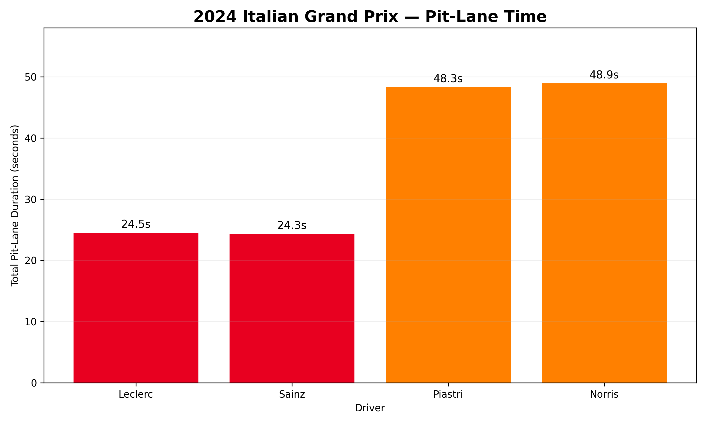
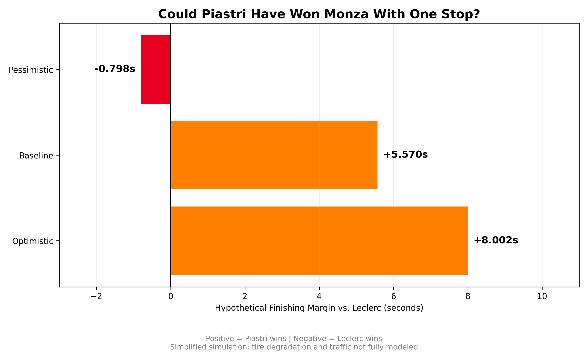

# F1 Race Strategy Analysis | 2024 Italian Grand Prix

## Project Overview

Could Oscar Piastri have won the 2024 Italian Grand Prix if McLaren had used a one-stop strategy instead of two stops?

This project uses real Formula 1 race data, SQL, and Python to analyze pit-stop decisions, tire performance, and race pace during the 2024 Italian Grand Prix at Monza.

The objective is to investigate whether McLaren's second pit stop was necessary and evaluate alternative race strategies through scenario modeling.

## Tools & Technologies

- **SQLite:** Relational database creation and querying
- **SQL:** JOINs, aggregations, CTEs, subqueries, and conditional logic
- **Python:** Data visualization
- **Matplotlib:** Race strategy charts
- **DB Browser for SQLite:** Database management
- **Google Colab:** Python development environment

## Dataset

The analysis focuses on four drivers:

| Driver | Team | Strategy |
|---|---|---|
| Charles Leclerc | Ferrari | One stop |
| Carlos Sainz | Ferrari | One stop |
| Oscar Piastri | McLaren | Two stops |
| Lando Norris | McLaren | Two stops |

Data was obtained from archived OpenF1 race records for the 2024 Italian Grand Prix.

**Source:** [OpenF1](https://openf1.org/)

The database contains four primary tables: `drivers`, `laps`, `stints`, and `pit_stops`.

## Analysis

### 1. Pit-Stop Strategy

Ferrari completed the race using one pit stop per driver, while McLaren used two.



The additional pit stop increased McLaren's total pit-lane duration, creating a trade-off between time lost in the pits and performance gained from fresher tires.

### 2. Tire Performance

SQL queries were used to compare average lap times across tire stints and evaluate how performance changed as tires aged.

Piastri averaged **1:23.450** over laps 31–37, compared with Leclerc's **1:23.550**.

This indicated that Piastri remained competitive immediately before his second stop, although lap-time differences alone cannot isolate tire degradation.

### 3. One-Stop Strategy Simulation

A simplified model estimated Piastri's potential finishing position if he had stayed on his original hard tires.

Three scenarios were tested using different assumed average lap times for laps 38–53.



| Scenario | Assumed Average Lap | Hypothetical Winning Margin |
|---|---|---|
| Optimistic | 1:23.450 | +8.002s |
| Baseline | 1:23.602 | +5.570s |
| Pessimistic | 1:24.000 | −0.798s |

Positive margins indicate a hypothetical Piastri victory, while negative margins indicate Leclerc remains ahead.

### 4. Break-Even Analysis

The model estimated that Piastri needed to average approximately **1:23.950** across laps 38–53 to match Leclerc's finishing time.

This provides a measurable threshold for evaluating the feasibility of a one-stop strategy.

## Key Findings

- Piastri remained marginally faster than Leclerc during laps 31–37.
- The estimated time loss associated with Piastri's second stop was approximately 24.583 seconds.
- Under the baseline scenario, the simulation projected Piastri finishing 5.570 seconds ahead of Leclerc.
- The simulated outcome was sensitive to assumptions about late-race tire performance.

**Conclusion:** A one-stop strategy may have offered Piastri an opportunity to win the 2024 Italian Grand Prix. However, the model does not establish that this outcome would have occurred in practice.

## Limitations

This analysis uses simplified assumptions rather than a complete race simulation.

It does not fully account for traffic, tire degradation, changing fuel loads, track conditions, or how other drivers might have responded to a different McLaren strategy.

The hypothetical results should therefore be interpreted as exploratory estimates rather than definitive alternative race outcomes.

## Repository Structure

```text
f1-race-strategy-sql/
├── data/
│   ├── raw/
│   ├── processed/
│   └── f1_strategy.db
├── sql/
│   ├── 01_database_overview.sql
│   ├── 02_pit_stop_analysis.sql
│   ├── 03_tire_performance.sql
│   └── 04_strategy_simulation.sql
├── charts/
│   ├── pit_stop_comparison.png
│   └── strategy_simulation.png
└── README.md
```

## Skills Demonstrated

SQL querying, relational database design, data cleaning and preparation, exploratory data analysis, scenario modeling, data visualization, and analytical problem-solving.

## Future Improvements

Future versions could incorporate lap-by-lap tire degradation models, race-position data, traffic effects, and more advanced strategy simulations.